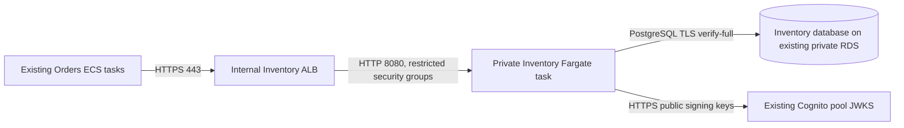

# Section 13.1 — Private Inventory Deployment Foundation

## 1. Status and sequence

Section 12.7 verified real Cognito tokens between disposable Orders and Inventory applications. This section prepares the private AWS hosting foundation and production-ready Inventory health/TLS configuration.

**Prepared, not deployed:** the live Terraform preview reports **28 additions, 0 changes, 0 deletions**. The user approved the Inventory IAM grants, and the scoped read/management policies are now installed. Foundation deployment has not been approved or applied. The Fargate service is intentionally inactive while `inventory_image` is empty. Existing Orders tasks, API image pin, application databases, and company-domain registration remain running and unchanged.

The deployment sequence is deliberate:

1. Review and approve the Inventory-scoped Terraform permissions and foundation plan.
2. Deploy the foundation through the existing approved Terraform workflow.
3. Publish the tested Java image and initialize its dedicated database secret.
4. Implement/run a private database-bootstrap task to create `inventory` and its restricted `inventory_app` login on the existing RDS instance.
5. Pin the Inventory image digest in reviewed Terraform configuration, then activate the private service and verify its health from inside the VPC.
6. Connect the deployed Orders API only after the separate migration/configuration review and AWS integration smoke tests.

Steps 4–6 are the next deployment phase. Do not set the image activation variable before database bootstrap succeeds.

## 2. Architecture and isolation



The internal ALB uses application subnets and private IP addresses. A private Route 53 zone, `internal.kaddigitalsolutions.com`, resolves `inventory.dev.internal.kaddigitalsolutions.com` inside this VPC. It does not shadow the public API's domain.

An ACM certificate covers the private Inventory hostname. Its DNS validation record is placed in the existing public company zone to prove domain control; the application record is private. HTTPS terminates at the internal ALB, which forwards HTTP to port 8080 across restricted security groups. PostgreSQL connections independently require TLS with hostname verification and the RDS CA bundle.

Security-group paths:

| Source | Destination | Port |
| --- | --- | --- |
| Existing API security group | Internal Inventory ALB | 443 |
| Inventory ALB security group | Inventory task security group | 8080 |
| Inventory task security group | Existing PostgreSQL security group | 5432 |
| Inventory task security group | HTTPS endpoints through existing NAT | 443 |

There is no public task IP or public inbound Inventory rule. The private hostname is not expected to open in a browser outside the VPC. No new NAT gateway or RDS instance is introduced.

## 3. Estimate incremental running cost

Using approximately 730 hours/month in US East (N. Virginia):

| Component | Approximate monthly cost |
| --- | --- |
| Internal ALB base charge, $0.0225/hour | $16.43 plus LCU usage |
| Private Route 53 hosted zone | $0.50 |
| Dedicated Secrets Manager secret | Approximately $0.40 plus API calls |
| Later Inventory task: 0.5 vCPU / 1 GiB | Approximately $18.02 |
| ECR storage, CloudWatch logs, transfer | Usage-dependent |

Foundation-only standing cost is approximately $17–18/month plus usage, because the task remains disabled. After activating one task, budget roughly $35–40/month plus usage. Existing infrastructure and Cognito costs are additional. Database storage/compute contention can grow even though no second RDS instance is created.

Verify current [ALB pricing](https://aws.amazon.com/elasticloadbalancing/pricing/), [Fargate rates](https://docs.aws.amazon.com/solutions/latest/prebid-server-deployment-on-aws/cost1.html), [Route 53 pricing](https://aws.amazon.com/route53/pricing/), and [Secrets Manager pricing](https://aws.amazon.com/secrets-manager/pricing/) before deployment. The existing daily budget is an alert, not a spending cap.

## 4. Review the prepared files

| File | Purpose |
| --- | --- |
| `infra/aws/dev/inventory-foundation.tf` | ECR, private DNS/TLS ALB, dedicated secret metadata, log groups, and network rules |
| `infra/aws/dev/inventory-iam.tf` | Separate publisher, secret initializer, ECS execution, and application task roles |
| `infra/aws/dev/inventory-service.tf` | Image-digest activation guard and private ECS task/service definitions |
| `.github/workflows/publish-inventory.yml` | Build/test and publish the Java image to its immutable ECR repository |
| `.github/workflows/initialize-inventory-secret.yml` | Approved, idempotent initialization of only the dedicated database secret |
| `infra/iam/inventory-terraform-plan.json` | Proposed additional Terraform metadata-read permissions |
| `infra/iam/inventory-terraform-apply.json` | Proposed Inventory-scoped infrastructure management permissions |
| `scripts/initialize-inventory-permissions.ps1` | Account-checked installation of the two proposed policies after approval |

The live foundation plan creates 28 Terraform-managed resources. The ECS task definition and service are excluded by their empty image variable; database credentials and the logical database are not created by the foundation plan.

## 5. Review and approve the additional IAM permissions

The earlier IAM approval covered Cognito, not this new Inventory hosting scope. Review both proposed Inventory policy files before running the bootstrap.

The policies scope repository, secret metadata, log groups, ECS service/task definitions, and IAM roles to Inventory names. Certificate management requires Inventory tags. Load-balancer writes target the private Inventory names. DNS record changes are restricted to the Inventory hostname and its validation labels. AWS operations that require wildcard resources, such as creating a hosted zone or listing regional metadata, remain visible in the policy for review.

The policy does not grant `DeleteHostedZone`, so it cannot remove the company zone through that action. Terraform-role permissions also do not grant reading the Inventory database password; credential initialization and ECS injection use separate dedicated roles. Existing VPC security-group permissions are reused.

After explicit approval:

```powershell
./scripts/initialize-inventory-permissions.ps1 -Profile order-management-dev
```

The script verifies account 638500336727 and creates two named managed policies. The plan role receives the read policy; the apply role receives both the read and management policies. Reusing the read policy keeps each document within the 6,144-character IAM quota without changing effective permissions. It fails instead of overwriting an existing policy whose contents differ. Do not replace a denied permission with AdministratorAccess.

## 6. Deploy only the foundation

1. Merge the reviewed changes after Build and Test and Terraform validation pass.
2. Open GitHub Actions → **Terraform AWS Dev** on `main` with `apply=false`.
3. Require the expected 28 additions, no existing-resource replacements, and no deletions. Investigate any difference.
4. Run with `apply=true` to create a new private saved plan.
5. Review and approve the `terraform-dev` environment apply job.
6. Confirm successful creation and the non-secret `inventory_foundation` output.

The certificate can take several minutes to validate. The internal ALB has no healthy application target at this stage; that is expected because the service remains disabled. Do not change health checks to accept errors to make an empty target group appear healthy.

## 7. Publish the Java image

After the ECR repository and publisher role exist:

1. Open **Publish Inventory Image** on main.
2. The Docker build runs the Java tests and packages the tested application with the RDS CA bundle.
3. The workflow assumes only the Inventory publishing role and publishes an immutable commit tag.
4. Copy the digest-based image reference from its summary for the later service activation review.

The publisher role uses the exact immutable GitHub repository/owner IDs and main-branch subject. It cannot push into the Orders API repository. Tagged images are retained for pinned deployments/rollback; only untagged images expire after seven days.

## 8. Initialize credentials without changing an existing login

1. Open **Initialize Inventory Database Secret** on main.
2. Approve its `terraform-dev` environment job.
3. The workflow generates a random password in memory and stores `{username: inventory_app, password: ...}` in the dedicated secret.
4. If an AWSCURRENT version already exists, it reports that the secret is initialized and does not rotate credentials.

No password is printed, added to Terraform configuration, or uploaded as an artifact. This initializes a secret, not a PostgreSQL role or database. The next phase must bootstrap the corresponding logical database/login from inside the private network using an approved one-off task.

## 9. Runtime behavior prepared for activation

The task template uses 0.5 vCPU and 1 GiB memory, limits Java heap percentage, enables graceful shutdown, injects the dedicated database credentials through the ECS execution role, and selects the production/Cognito configuration validated in Section 12.7.

The production JDBC URL uses `sslmode=verify-full` and `/app/certs/global-bundle.pem`. The connection pool is bounded to five connections per task. Flyway startup migrations operate within the service-owned database once bootstrap has provisioned it; Orders migrations remain separate.

Only health management endpoints are exposed, with details suppressed:

- `/actuator/health/liveness` checks application liveness.
- `/actuator/health/readiness` includes database availability and is the ALB target health path.
- `/actuator/health` provides aggregate status.

Other management endpoints remain unavailable. Swagger is disabled in the prepared production task. Existing Inventory operation permissions remain enforced, including the reservation-only Cognito client scope.

## 10. Activate only after database bootstrap

Do not activate yet. In the next phase, after database bootstrap and image publication succeed, commit a reviewed non-secret `inventory.auto.tfvars` containing:

```hcl
inventory_image = "638500336727.dkr.ecr.us-east-1.amazonaws.com/inventory-service@sha256:<verified-64-character-digest>"
```

A mutable tag or another repository fails validation. The activation plan should add the ECS task definition and service, leaving the existing Orders service unchanged. Verify task stability, target health, TLS, and Cognito-protected requests from an approved task inside the VPC before connecting Orders.

The baseline is a single Inventory task and a shared RDS instance. It does not yet provide multi-task capacity, independent database compute, production load evidence, or complete operational alarms. Those limitations must stay visible in the final handoff.

## 11. Verification evidence and next work

- Terraform format and validate passed using Terraform 1.17.2 / AWS provider 6.73.0.
- The live foundation plan reports 28 additions, 0 changes, 0 deletions, with no active Inventory ECS task/service.
- AWS IAM Access Analyzer returned no findings for either proposed policy after correcting an invalid action during preparation.
- All 35 Java tests passed, including anonymous health probes with hidden database details and unavailable management configuration endpoints.
- The Linux Java image build passed all 35 tests, and all 20 disposable Orders/Inventory integration and recovery assertions passed.
- Preparation initially installed no policies. After explicit user approval, the Inventory read/management policies were installed; no foundation resources have been applied.

Next work is private database bootstrap, image pinning/service activation, an in-VPC smoke-test mechanism, and then the reviewed Orders AWS integration. Keep current AWS resources running throughout this project.

The final runtime-image check caught and corrected certificate-directory traversal permissions. The Dockerfile now checks CA readability after switching to the non-root application user, and the rebuilt image passed that check.

## 12. IAM installation and deployment approval status

The approved IAM bootstrap completed. The original combined apply document exceeded AWS's 6,144-character managed-policy limit. It was split by reusing the existing approved read policy on the apply role and keeping only management statements in the apply document. Comparing the combined statements with the reviewed original confirmed unchanged effective permissions.

Starting the resource apply workflow was rejected by automatic approval review because the user had approved IAM changes only, not the 28 persistent foundation resources and recurring hosting cost. A plan-only main-branch workflow was started instead. Foundation creation still requires explicit deployment approval, followed by the repository's normal saved-plan/environment review.
