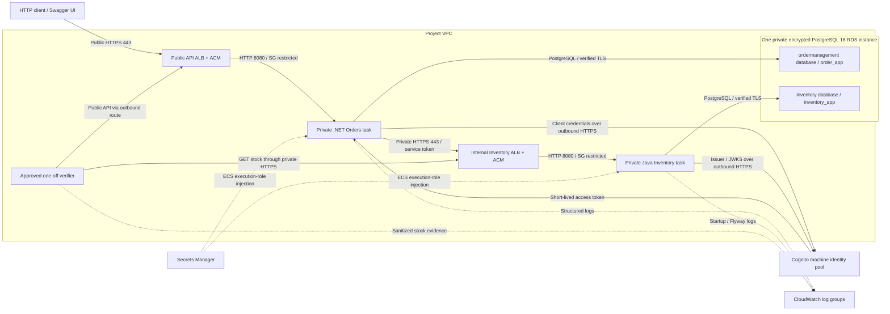
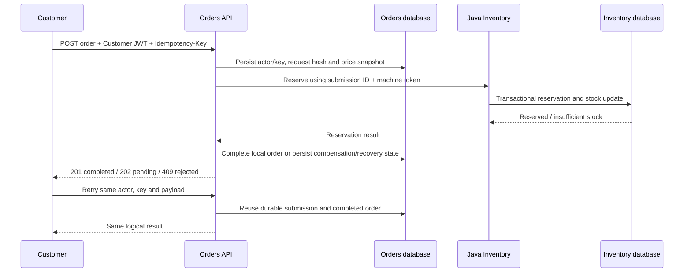
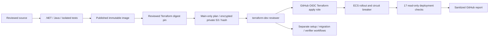

# Current architecture

Recorded 28 November 2026. Terraform and the pinned image values remain the source of truth for a later release.

## Runtime and trust boundaries

Both application tasks have no public IP. ALB-to-task traffic is restricted by security groups. Managed-service HTTPS/image/log/token access uses the existing outbound/NAT path. Database access is restricted to the intended application/setup security groups. The verifier has HTTPS access and no database rule or secret-read permission.

Customer login uses ASP.NET Core Identity and the API's JWT issuer. Cognito is the separate machine identity for Orders-to-Inventory, not a replacement for Customer login. Product reads are public; product mutation/user administration are privileged; Customers can access only their own orders. Inventory stock changes/reservation operations require their configured scopes; Orders receives reservation scope, not stock administration scope.

## Order submission and recovery

The services do not share a distributed database transaction. Local transactions, durable submission state, idempotent reservation/release, and a background recovery worker handle the boundary. The API recovery worker polls approximately every 10 seconds; leases prevent normal duplicate processing. A changed payload under the same actor/key conflicts. Existing pre-integration orders may have no submission link.

## Delivery and administration boundary

RDS administrator credentials are restricted to controlled setup tasks. The running API and Inventory use their dedicated logins. Execution roles obtain injected secrets; application task roles have no new general AWS data access. The private verifier creates Customer credentials in memory and needs no injected secret.

## Current scope and limits

This is a development learning deployment: one task per service, one shared single-AZ RDS instance with separate logical databases, and no frontend. Seven-day database backups and short log retention are configured. A restore drill, AWS outage/load drill, multi-AZ capacity, full distributed tracing/alerting, end-user federation, Kafka, and Kubernetes are not claimed implemented. The local/CI recovery and concurrency tests and the controlled real AWS stock verification are distinct evidence.
