# Section 14 - Approved deployment with automatic read-only verification

## Status

Completed in the approved main-branch [demonstration run 46126700549](https://github.com/Dagmaw/order-management-system/actions/runs/46126700549) on 28 November 2026. Apply reported zero resources added, changed, or destroyed; all 17 automatic checks passed and the sanitized artifact uploaded successfully. No application image pin or IAM permission changed.

## 1. Release contract

The trusted Build and Test pipeline tests a main-branch commit and publishes its API image to ECR. Java and verification images use their dedicated publishing workflows. Deployment uses an immutable image digest pinned in Terraform and reviewed in a PR; publishing an image does not automatically deploy it.

For an application release, review the source commit, successful tests, published digest, migration prerequisites, and exact Terraform diff. For documentation or Terraform-only commits, do not keep changing application image pins just because another CI image was published. Keep the reviewed deployed digest until a deliberate application release.

```mermaid
flowchart LR
  A[Tests and image publication] --> B[Reviewed immutable digest pin]
  B --> C[Fresh saved Terraform plan]
  C --> D[Private encrypted plan and hash]
  D --> E[terraform-dev approval]
  E --> F[Apply exact saved plan]
  F --> G[Service stability and image checks]
  G --> H[Read-only API and authorization checks]
  H --> I[Sanitized report and workflow result]
```

## 2. Existing approval and plan protections

The workflow remains main-only for plan/apply and retains the existing terraform-dev reviewer gate. It stores the saved plan privately in encrypted S3 after checking public-access blocking, verifies the plan hash before apply, and serializes applies. Secret-bearing plans and state are never uploaded as public GitHub artifacts.

Terraform's service resources already wait for steady state and keep their deployment circuit breakers enabled. The new checks run only after apply succeeds and the applied private plan is removed. They do not bypass the gate, automatically choose another image, retry an old saved plan, or create test data.

## 3. Non-secret expected deployment

`infra/aws/dev/deployment-verification.tf` exports `deployment_verification`: project account/region/cluster, public API origin, and each selected service's name, task-definition revision, immutable image, container name, and target-group ARN. It contains no passwords, client secrets, JWTs, database connection strings, or secret payloads.

The output includes Inventory when its image is selected. The gate requires the project account and fixed HTTPS development API origin. Expectations come from the approved Terraform configuration, not from guessing the most recently published tag.

## 4. Automatic verification

After a successful apply, the workflow exports only that output and invokes `scripts/verify_deployment.py`.

For each expected service it requires:

1. ACTIVE service with a positive desired count, running equal to desired, zero pending tasks, and a completed primary deployment.
2. The service and primary deployment both reference the reviewed task-definition revision, catching a rollback to an earlier revision.
3. The expected container in that task definition uses the reviewed immutable project-repository image pin.
4. The expected target group is attached.
5. At least the desired number of active targets are healthy. Draining/unused targets are excluded; active unhealthy or initial targets fail the gate.

It then performs GET-only public checks:

- `/health`: HTTP 200 and Healthy.
- `/api/products`: HTTP 200 JSON list.
- `/api/auth/me`: HTTP 401 without a token.
- `/api/orders`: HTTP 401 without a token.
- `/openapi/v1.json`: valid OpenAPI 3 document with order/login paths.

The current two-service configuration has 17 checks. Redirects are rejected and TLS verification remains enabled. It checks task-definition image pins; it does not independently query every running container's imageDigest field. Inventory's private HTTP readiness is observed through target-group health, not through opening its private endpoint publicly.

## 5. Results and failure behavior

The gate produces `artifacts/deployment-verification.json` and a GitHub job summary. The workflow uploads only that sanitized report as `deployment-verification`. No raw task definition, full HTTP response, Terraform state, saved plan, or credential is uploaded.

A failed check makes the workflow fail even if Terraform apply succeeded. This means infrastructure application and runtime acceptance are distinct outcomes. Inspect the named failed check and service events before deciding on recovery. A post-check failure does not roll back the database or automatically redeploy an old API; that could bypass Inventory reservation semantics.

If apply itself fails, the verification steps do not run. An absent report is reported as a missing artifact rather than pretending verification passed. If a provider waiter fails after a healthy rollout, use the verified state-reconciliation procedure from Section 13.3 and make a fresh plan; do not reuse the stale plan.

## 6. Validation completed before merge

- Nine offline tests passed for happy path, wrong account, rolled-back revision, incomplete rollout, wrong image, unhealthy/empty targets, anonymous authorization regression, and missing OpenAPI contract.
- Terraform formatting and validation passed.
- Live preview confirmed zero infrastructure resource changes; only the non-secret output is added.
- The checker passed all 17 read-only checks against the live AWS services without creating accounts, orders, or reservations.
- IAM simulation confirmed the existing apply role allows service reads plus the non-resource-scoped task-definition and target-health reads in us-east-1. No IAM change is needed.

## 7. First approved workflow demonstration

1. Review and merge this PR after CI passes.
2. Start Terraform AWS Dev on main with apply enabled.
3. Review the fresh saved plan. It should contain no resource additions, changes, or deletions and only the new non-secret output.
4. Choose Review deployments, terraform-dev, then Approve and deploy. The environment gate remains required even for an output-only apply.
5. Require successful apply, successful automatic verification, the 17-check report, and a green workflow result.
6. Record the workflow URL in this section. This establishes the pipeline behavior, rather than treating the local helper run as the workflow demonstration.

For future approved releases, these checks run automatically after apply. Deliberate stock-changing verification remains the separate VPC task from Section 13.9; do not run that mutating test after every Terraform-only change.

## 8. Following handoff

Prepare the final architecture/deployment diagrams, troubleshooting and rollback runbook, and repeatable demo with these verified workflow links. Keep isolated concurrency/outage coverage distinct from real AWS smoke evidence. The remaining career-practice goals belong to the broader 30-day plan and are not inferred complete from software deployment.

## 9. Workflow demonstration evidence

[Run 46126700549](https://github.com/Dagmaw/order-management-system/actions/runs/46126700549) passed validation, saved-plan review/application, non-secret output export, automatic verification, and artifact upload. All 17 checks passed under the GitHub OIDC Terraform apply role, not just a local profile.

The [sanitized deployment-verification artifact](https://github.com/Dagmaw/order-management-system/actions/runs/46126700549/artifacts/15255847963) was uploaded successfully. Historical artifacts may expire according to GitHub retention; the run URL, checked source, and recorded outcomes remain the project evidence. This demonstration created no Customer, order, or reservation and changed no infrastructure resources.
